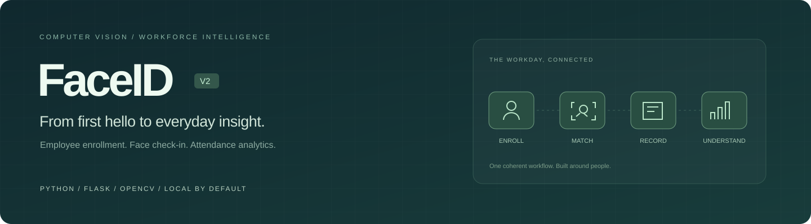
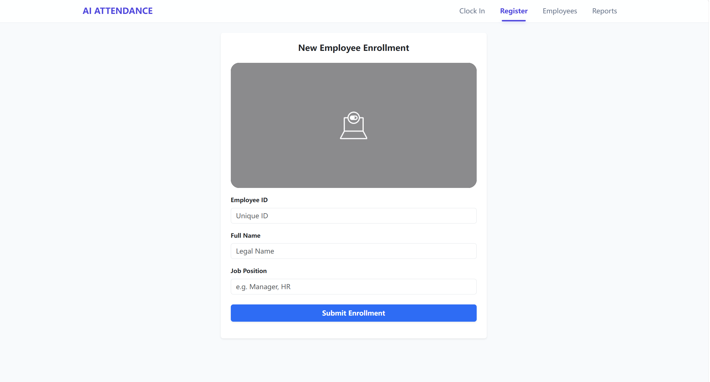
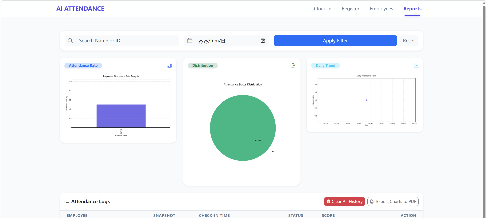
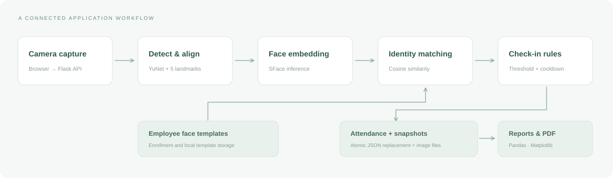

<p align="center"></p>

<h1 align="center">FaceID · AI Smart Attendance</h1>

<p align="center"><strong>A complete computer vision workflow for employee enrollment, face check-in, and attendance insights.</strong></p>

<p align="center"><strong>Enterprise Edition V2</strong> · Built by <a href="https://github.com/yl8892732-oss">Chenyu Huang</a></p>

<p align="center">
  
  
  
  
</p>

<p align="center"><a href="#product-tour">Product tour</a> · <a href="#quick-start">Quick start</a> · <a href="#architecture">Architecture</a> · <a href="#engineering-details">Engineering</a> · <a href="#中文说明">中文说明</a></p>

---

## Why I built this

A face recognition model is one part of an attendance system. The application also needs to connect an identity to an employee, record a check-in reliably, explain what happened, and make the resulting data useful.

FaceID brings those pieces into one local web workspace. I developed it across two versions, moving from the initial recognition-and-reporting flow toward a more complete application with employee lifecycle management, snapshot evidence, safer file persistence, and clearer reporting.

My original ArcFace training work was based on [peteryuX/arcface-tf2 at commit `d0d9fc7`](https://github.com/peteryuX/arcface-tf2/commit/d0d9fc7ada4701001d7c5b233b820d8ee9d35b52). This project connects that face-recognition foundation to a practical attendance application.

**The focus: connecting computer vision to the everyday workflow around it.**

## Product tour

### 01 / Employee enrollment

A camera-based registration flow connects an employee ID, name, role, enrollment photo, and face embedding.



### 02 / Attendance insights

Review attendance indicators, check-in distribution, daily activity, and timestamped records. Filter by employee or date and export the charts to PDF.



<sub>Actual application screenshots supplied by the author. The registration preview shows the camera state available at capture time.</sub>

## What the application does

| Workspace | Capabilities |
| :-- | :-- |
| **Employee enrollment** | Browser camera capture, unique employee IDs, profile creation, face alignment, and embedding storage. |
| **Face check-in** | Local detection and matching, unknown-person feedback, multi-face rejection, and a 30-second duplicate check-in cooldown. |
| **Employee directory** | Enrollment photos, employee roles, profile dates, and removal of a profile with its associated face templates and photo. |
| **Attendance records** | Check-in timestamps, cosine similarity scores, and captured snapshot evidence. |
| **Insights & reporting** | Name/ID and date filters, attendance indicators, status distribution, daily unique check-ins, and chart export to PDF. |
| **Local workspace** | Local inference and file storage; bundled frontend dependencies for use without runtime CDN requests. |

## Quick start

### Launch the local demo

The current local demo has been tested with **Python 3.12**. With the project environment and model assets configured, run:

```powershell
python Web_Frontend.py
```

1. Open **<http://127.0.0.1:5010>** and allow camera access.
2. Go to **Register**, create an employee profile, then test **Clock In**.
3. Open **Reports** to review the resulting attendance record.

The prepared Windows test environment also includes `start.bat` and `stop.bat`. See [RUN_LOCAL.md](RUN_LOCAL.md) for its setup notes.

## Technology & model lineage

| Layer | Implementation |
| :-- | :-- |
| **Application** | Python 3.12, Flask, OpenCV, Pandas, Matplotlib |
| **Interface** | Responsive HTML, CSS, JavaScript, Bootstrap, html2pdf.js |
| **Current local demo** | YuNet detection, five-landmark alignment, SFace embeddings, cosine matching |
| **ArcFace training foundation** | TensorFlow ArcFace / ResNet50, based on [peteryuX/arcface-tf2 (`d0d9fc7`)](https://github.com/peteryuX/arcface-tf2/commit/d0d9fc7ada4701001d7c5b233b820d8ee9d35b52) |
| **Storage** | Local JSON records and image assets, with atomic file replacement |

SFace matching uses a default cosine threshold of **0.363**, following the [OpenCV face recognition tutorial](https://docs.opencv.org/4.x/d0/dd4/tutorial_dnn_face.html). This is a starting point, not an accuracy claim; a deployment threshold needs evaluation on representative data. The score shown in the interface is similarity, not recognition probability. Changing embedding models requires re-enrollment.

Model references: [YuNet](https://github.com/opencv/opencv_zoo/tree/main/models/face_detection_yunet) · [SFace](https://github.com/opencv/opencv_zoo/tree/main/models/face_recognition_sface)

## Architecture



**Capture → detect & align → embed → match → record → understand.** The current local demo uses YuNet and SFace for the vision stages. Employee templates feed cosine matching; accepted matches pass the threshold and cooldown rules before producing a record and snapshot.

## Engineering details

**Persistence with atomic replacement.** JSON writes go through a temporary file followed by `os.replace`, reducing the risk of leaving a partially written destination file. This is local file persistence, not a transactional multi-user database.

**An identity lifecycle, beyond the embedding.** Employee deletion removes the profile, associated face templates, and enrollment photo. Individual attendance deletion removes its snapshot; historical records can still be reported after an employee profile is removed.

**Traceable check-ins.** A successful match produces a timestamped record with a similarity score and a local camera snapshot. The cooldown reduces duplicate check-ins; it is not liveness detection or proof against presentation attacks.

**Operational visibility.** Pandas merges employee and attendance records for filtering, charting, and reporting. The current attendance indicator uses a rule-based score: on-time check-ins contribute 1.0 and late check-ins 0.5. It is an application indicator, not an estimate of scheduled workforce attendance.

**A connected workflow.** Registration, check-in, employee management, and reporting share one application, so the recognition result can flow into an employee record and a useful management view.

## From V1 to V2

| Area | V1 foundation | V2 direction |
| :-- | :-- | :-- |
| Recognition workflow | Face recognition, registration, and reports | An integrated employee and attendance workspace |
| Data handling | Basic application persistence | Atomic JSON replacement and clearer runtime paths |
| Lifecycle | Employee enrollment | Profile, template, and associated photo cleanup |
| Reporting | Attendance reports | Filtered records, status charts, snapshot evidence, and PDF chart export |
| Project documentation | A short project description | Architecture, engineering details, model references, and actual running screenshots |

The original V1 project is available [here](https://github.com/yl8892732-oss/Enterprise_intelligent_attendance_system).

## Validation

The local configuration was exercised with real pretrained models and public OpenCV sample images using an isolated temporary database. Checks covered:

- Page rendering, empty-state charts, and malformed input handling.
- Enrollment, duplicate employee IDs, and matching after an image brightness change.
- Rejection of a different sample identity, blank frames, and multi-face input.
- Duplicate check-in cooldown, snapshot creation, report filtering, deletion, and photo cleanup.
- Reporting historical records after employee profiles have been removed.

These are integration checks, **not a biometric accuracy benchmark**. Camera behavior still depends on browser permission, the device, lighting, and image quality.

## Repository map

```text
FaceID_Proiect/
├── Web_Frontend.py           # Flask pages and image APIs
├── Face_recognizer.py        # Template cache and cosine matching
├── Database.py               # Employee, template and attendance persistence
├── Flow_control.py           # Check-in cooldown and flow helpers
├── Reports_analytic.py       # Attendance summaries and charts
├── ArcFace_model/            # Original TensorFlow model source
├── templates/                # Enrollment, check-in, directory and reports
├── docs/images/              # Project cover and actual running screenshots
├── config.py                 # Runtime and recognition settings
├── requirements.txt          # Python dependency requirements
└── RUN_LOCAL.md              # Local setup and troubleshooting
```

## Scope & next steps

This repository is a **local demonstration and development project**, binding to `127.0.0.1`. The on-time cutoff is currently **09:00 local time**. Next steps include configurable shifts, measured model evaluation, a transactional database, and administration and access controls.

Employee photos, biometric templates, records, logs, and downloaded model binaries are excluded from Git. The application performs face inference locally and does not call an external recognition service.

## 中文说明

这是一个将人脸识别接入完整考勤流程的 AI 应用项目，覆盖员工注册、人脸打卡、档案管理、记录追溯和可视化报表。

V2 的重点是把模型与软件工程结合起来：原子化 JSON 写入、员工与人脸模板的生命周期管理、打卡快照、重复打卡冷却，以及统一的管理界面。ArcFace 训练基于 [peteryuX/arcface-tf2 的指定提交](https://github.com/peteryuX/arcface-tf2/commit/d0d9fc7ada4701001d7c5b233b820d8ee9d35b52)；当前本地演示使用 YuNet + SFace。

Windows 本地运行：双击 `start.bat`，访问 `http://127.0.0.1:5010`。先在 Register 注册，再到 Clock In 打卡，最后在 Reports 查看记录。停止服务可双击 `stop.bat`。

## License & acknowledgments

Project source is released under the [MIT License](LICENSE). Pretrained models and bundled frontend dependencies retain their respective licenses, saved alongside their files. The TensorFlow ArcFace implementation builds on [peteryuX/arcface-tf2](https://github.com/peteryuX/arcface-tf2/commit/d0d9fc7ada4701001d7c5b233b820d8ee9d35b52). Thanks also to [OpenCV Zoo](https://github.com/opencv/opencv_zoo), Flask, Pandas, Matplotlib, Bootstrap, Bootstrap Icons, and html2pdf.js.
